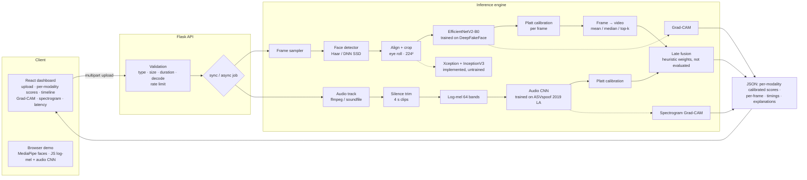
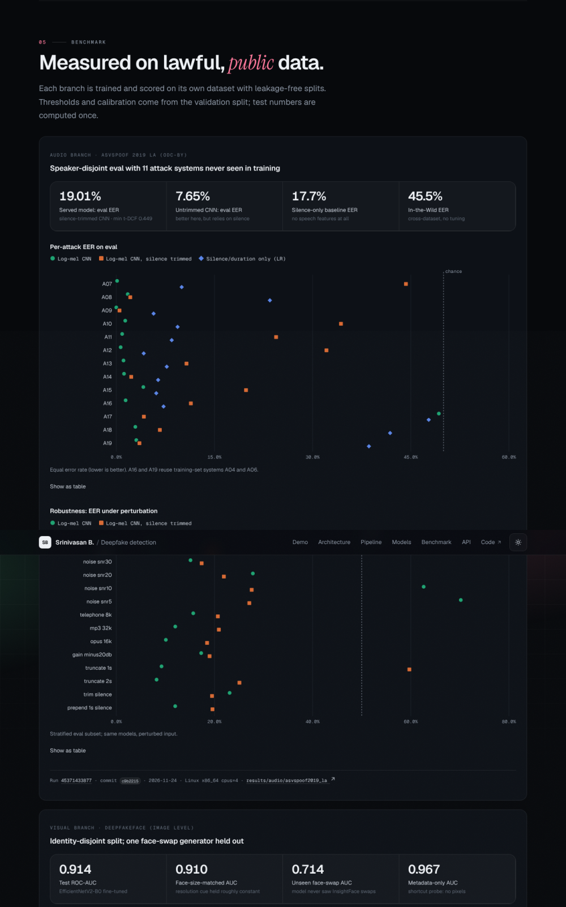
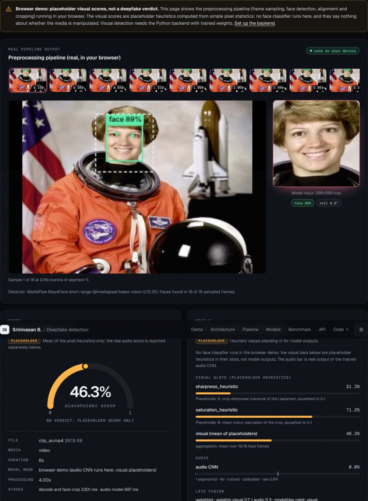
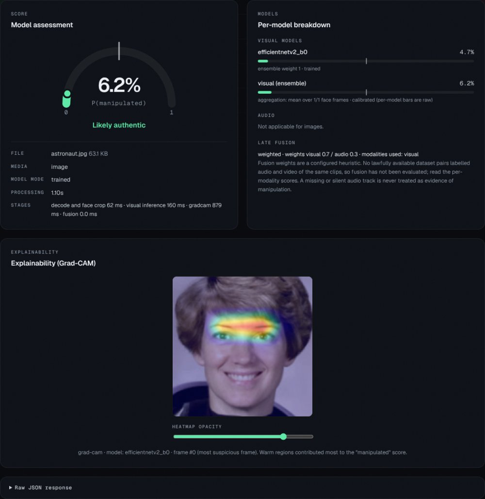
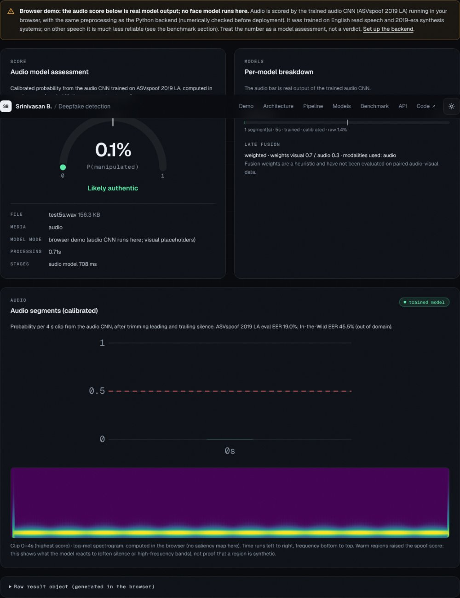

# Multi-Modal Deepfake Detection System

[](https://github.com/srini2k03/multimodal-deepfake-detection/actions/workflows/ci.yml)
[](https://srini2k03.github.io/multimodal-deepfake-detection/)


[](LICENSE)

Face and voice manipulation detectors, trained and evaluated on **lawfully available public data**
with leakage-free splits, then served through a Flask API and a React dashboard. The visual branch
covers face detection, alignment, a CNN classifier, frame-to-video aggregation and Grad-CAM. The
audio branch covers log-mel features, a CNN and spectrogram saliency. Both report calibrated
probabilities. Every score is a probabilistic model assessment, never a verdict.

> **What is and is not established.** The audio branch is trained and evaluated on ASVspoof 2019 LA
> (speaker-disjoint, with unseen attacks) and tested cross-dataset on In-the-Wild. The visual branch
> is trained and evaluated at image level on DeepFakeFace (identity-disjoint, one generator held
> out) and tested cross-dataset at video level on WildDeepfake. **Audio-visual fusion is implemented but not evaluated**, because every dataset with paired,
> labelled audio and video needs an access request ([why](docs/DATASETS.md#consequence-for-fusion)).
> The Xception + InceptionV3 ensemble and the attention temporal head are implemented and tested, but
> not trained, because the data they were designed for (FaceForensics++, Celeb-DF) is gated. Every
> number below comes from a workflow run whose output is committed in [`results/`](results).

**Live demo:** <https://srini2k03.github.io/multimodal-deepfake-detection/>. The face pipeline
(sampling, MediaPipe detection, alignment, crops) runs in your browser, and so does the **trained
audio CNN**: a JavaScript port whose output is checked numerically against Python before every
deployment. No face classifier runs in the browser, so visual scores there are labelled placeholders.

---

## Contents

- [Results at a glance](#results-at-a-glance)
- [Datasets](#datasets)
- [Architecture](#architecture)
- [Pipeline details](#pipeline-details)
- [Quick start](#quick-start)
- [Reproducing the benchmarks](#reproducing-the-benchmarks)
- [Training on other datasets](#training-on-other-datasets)
- [Inference and REST API](#inference-and-rest-api)
- [Browser demo](#browser-demo-github-pages)
- [Frontend](#frontend)
- [Configuration](#configuration)
- [Testing and CI](#testing-and-ci)
- [Screenshots](#screenshots)
- [Project structure](#project-structure)
- [Limitations and responsible use](#limitations-and-responsible-use)
- [References](#references)

## Results at a glance

<!-- results:start -->
| Branch | Test set | System | Result | Source |
|---|---|---|---|---|
| Audio | ASVspoof 2019 LA eval (unseen speakers, 11 of 13 attacks unseen) | Log-mel CNN, silence trimmed | EER **19.01%**, min t-DCF 0.449 | [run 45371433877](https://github.com/srini2k03/multimodal-deepfake-detection/actions/runs/45371433877) |
| Audio | ASVspoof 2019 LA eval (unseen speakers, 11 of 13 attacks unseen) | Log-mel CNN | EER **7.65%**, min t-DCF 0.138 | [run 45371433877](https://github.com/srini2k03/multimodal-deepfake-detection/actions/runs/45371433877) |
| Audio | ASVspoof 2019 LA eval (unseen speakers, 11 of 13 attacks unseen) | Log-mel statistics (LR) | EER **17.14%**, min t-DCF 0.456 | [run 45371433877](https://github.com/srini2k03/multimodal-deepfake-detection/actions/runs/45371433877) |
| Audio | ASVspoof 2019 LA eval (unseen speakers, 11 of 13 attacks unseen) | Silence/duration only (LR) | EER **17.74%**, min t-DCF 0.476 | [run 45371433877](https://github.com/srini2k03/multimodal-deepfake-detection/actions/runs/45371433877) |
| Audio | In-the-Wild (31,779 clips, cross-dataset) | Log-mel CNN, silence trimmed | EER **45.46%** | [run 45371433877](https://github.com/srini2k03/multimodal-deepfake-detection/actions/runs/45371433877) |
| Audio | In-the-Wild (31,779 clips, cross-dataset) | Log-mel CNN | EER **47.86%** | [run 45371433877](https://github.com/srini2k03/multimodal-deepfake-detection/actions/runs/45371433877) |
| Visual | DeepFakeFace test (identity-disjoint, images) | EfficientNetV2-B0 fine-tuned | ROC-AUC **0.914**, face-size-matched AUC 0.910 | [run 45373710322](https://github.com/srini2k03/multimodal-deepfake-detection/actions/runs/45373710322) |
| Visual | DeepFakeFace test (identity-disjoint, images) | Fine-tuned, 96 px resolution cap | ROC-AUC **0.894**, face-size-matched AUC 0.891 | [run 45373710322](https://github.com/srini2k03/multimodal-deepfake-detection/actions/runs/45373710322) |
| Visual | DeepFakeFace test (identity-disjoint, images) | EfficientNetV2-B0 frozen + LR | ROC-AUC **0.818**, face-size-matched AUC 0.817 | [run 45373710322](https://github.com/srini2k03/multimodal-deepfake-detection/actions/runs/45373710322) |
| Visual | DeepFakeFace test (identity-disjoint, images) | File metadata only (LR) | ROC-AUC **0.967**, face-size-matched AUC 0.964 | [run 45373710322](https://github.com/srini2k03/multimodal-deepfake-detection/actions/runs/45373710322) |
| Visual | DeepFakeFace test, face swaps never seen in training | Fine-tuned without face swaps | AUC on face swaps **0.714** | [run 45373710322](https://github.com/srini2k03/multimodal-deepfake-detection/actions/runs/45373710322) |
| Visual | WildDeepfake test (806 sequences, cross-dataset) | EfficientNetV2-B0 fine-tuned | frame AUC **0.628**, sequence AUC (mean) 0.653 | [run 45442329373](https://github.com/srini2k03/multimodal-deepfake-detection/actions/runs/45442329373) |
| Visual | WildDeepfake test (806 sequences, cross-dataset) | Fine-tuned, 96 px resolution cap | frame AUC **0.580**, sequence AUC (mean) 0.596 | [run 45442329373](https://github.com/srini2k03/multimodal-deepfake-detection/actions/runs/45442329373) |
| Fusion | none: no lawful paired audio-visual data | heuristic weighted average | **not evaluated** | [why](docs/DATASETS.md#consequence-for-fusion) |
| Serving | 10 s 720p video, 16 frames, CPU (4 vCPU) | API detector end to end | median **1.77 s** (2.21 s with Grad-CAM) | [run 45440058636](https://github.com/srini2k03/multimodal-deepfake-detection/actions/runs/45440058636) |
<!-- results:end -->

How to read these numbers:

- **Shortcuts.** On ASVspoof 2019 LA, silence alone gives 17.7% EER, and the untrimmed CNN's 7.65%
  relies on it: it reaches 21.6% on trimmed audio and flags every bona fide clip once a second of
  silence is prepended. The served audio model is the silence-trimmed CNN, which is worse in-benchmark
  but stable under noise and silence edits. On DeepFakeFace, file metadata alone (fakes are all
  512×512) gives AUC 0.967, higher than any image model, so the visual numbers measure
  generalisation within a biased dataset.
- **Out of distribution, both branches degrade sharply.** The audio branch is near chance on
  In-the-Wild (EER 45–48%). The visual branch drops on an unseen manipulation type (face-swap AUC
  0.877 → 0.714 when swaps are held out) and reaches only 0.653 video-level AUC on WildDeepfake.

Full tables, per-attack and per-manipulation breakdowns, robustness, calibration and latency:
**[docs/BENCHMARKS.md](docs/BENCHMARKS.md)**.

## Datasets

| Dataset | Used for | Licence (as published) | Access |
|---|---|---|---|
| [ASVspoof 2019 LA](https://datashare.ed.ac.uk/handle/10283/3336) | audio train / dev / eval | ODC-By 1.0 | open download |
| [In-the-Wild](https://huggingface.co/datasets/mueller91/In-The-Wild) | audio cross-dataset test only | CC BY-SA 4.0 card / CC BY-NC 4.0 site | ungated |
| [DeepFakeFace](https://huggingface.co/datasets/OpenRL/DeepFakeFace) | visual train / val / test (images) | OpenRAIL card; real photos from IMDB-WIKI (research use) | ungated |
| [WildDeepfake](https://huggingface.co/datasets/xingjunm/WildDeepfake) (test split) | visual cross-dataset, video-level test only | Apache-2.0 | ungated |

FaceForensics++, DFDC, Celeb-DF, DeeperForensics, FakeAVCeleb, LAV-DF, AV-Deepfake1M and DeepSpeak
need a form, an EULA or gated access, so they are not used. The repository still reads their
layouts for anyone who has access. The access checks are reproducible: the
[`dataset-access.yml`](.github/workflows/dataset-access.yml) workflow records what each host
reports in [`results/datasets/access_check.json`](results/datasets/access_check.json). Licences,
split construction and known biases: **[docs/DATASETS.md](docs/DATASETS.md)**. No dataset media is
committed to this repository.

## Architecture



## Pipeline details

**1. Frame sampling.** `sample_indices` picks `N` frames spread evenly across the video (the centre
of each of `N` segments), decoded in one sequential pass, which is more reliable than random
seeking across codecs.

**2. Face detection.** By default the Haar cascade bundled with OpenCV (no downloads). Set
`face.detector: dnn` for OpenCV's ResNet-10 SSD (`scripts/download_face_models.sh`); Haar is the
fallback. The largest face is kept, and frames without a face fall back to a centre crop that is
flagged in the response.

**3. Alignment without landmarks.** The box gets a 30% margin and is made square. A Haar eye
cascade estimates the roll angle and the crop is rotated so the eye line is level. The crop is
resized to the model input (224² for EfficientNetV2-B0, 299² for Xception/InceptionV3).

**4. Frame classifier.** EfficientNetV2-B0 (ImageNet weights) with a dropout and single-logit head.
Every classifier takes the same `[-1, 1]` input; EfficientNet's classifier maps it to `[0, 255]`
internally. Training is two-stage: one epoch on the head, then the top 30% of layers unfrozen with
BatchNorm kept frozen, with class-balanced epochs and augmentation applied to both classes alike
(flip, random JPEG, down/up-scaling, brightness). The Xception + InceptionV3 ensemble and its
two-stage recipe are still available.

**5. Frame to video.** Per-frame probabilities are aggregated by mean, median, max, top-k mean or
confidence weighting (`api.frame_aggregation`). An attention-pooling temporal head is implemented
(`α = softmax(vᵀ tanh(W hₜ))`), but it needs labelled video to train.

**6. Audio branch.** Audio is decoded (soundfile, ffmpeg for other containers), converted to mono
16 kHz and truncated to `audio.max_seconds`. Leading and trailing silence is trimmed when the
released model was trained that way, the audio is split into 4 s clips (repeat-padded), each clip
becomes a standardised 64-band log-mel spectrogram, and a 3-block CNN scores it. The utterance
score is the mean clip logit.

**7. Calibration.** Each branch's raw logits go through Platt scaling fitted on that dataset's
validation split, re-weighted to equal class priors (`weights/model_card.json`). Raw and calibrated
probabilities are both returned.

**8. Fusion.** A weighted average over the modalities that are present (visual 0.7, audio 0.3,
probability or logit space). Missing or silent audio is dropped, never counted as evidence. These
weights are a heuristic: **fusion has not been evaluated** (see [Datasets](#datasets)), and the
response says so in `fusion.validated: false`.

**9. Explanations.** Grad-CAM on the frame classifier's last convolutional block for the most
suspicious frame, and Grad-CAM on the audio CNN's last convolution over the log-mel spectrogram of
the most suspicious clip. They are diagnostic evidence of what the model reacts to, not proof.

## Quick start

```bash
git clone https://github.com/srini2k03/multimodal-deepfake-detection.git
cd multimodal-deepfake-detection

# Backend (Python 3.10-3.12)
python -m venv .venv && source .venv/bin/activate
make install            # TensorFlow + dev tools  (or: make install-dev for a TF-free setup)
make fetch-weights      # released models (SHA-256 checked) + calibration model card -> backend/weights/
make serve              # http://localhost:5000 with configs/serve.yaml (refuses to start without weights)

# Frontend (second terminal)
make frontend-install
make frontend-dev       # http://localhost:5173 (proxies /api to :5000)
```

Without weights, `make api` starts in a clearly labelled **demo mode** (untrained networks, warning
on every response). With Docker: `docker compose up --build` (web on :8080, API on :5000). Put the
fetched files in `backend/weights/`, which is mounted read-only. API settings can also come from
environment variables; see [`backend/.env.example`](backend/.env.example).

## Reproducing the benchmarks

All heavy compute runs in GitHub Actions on CPU runners. Each workflow downloads the data, trains,
evaluates, commits its JSON results and attaches the models to a release.

| Workflow | What it does | Output |
|---|---|---|
| [`benchmark-audio.yml`](.github/workflows/benchmark-audio.yml) | ASVspoof 2019 LA features → 2 CNNs + 2 linear baselines → eval, per-attack, calibration, robustness, latency/TFLite parity → In-the-Wild | `results/audio/asvspoof2019_la/`, release `audio-asvspoof2019-v1` |
| [`benchmark-visual.yml`](.github/workflows/benchmark-visual.yml) | DeepFakeFace identity-grouped split → face crops → metadata probe, frozen probe, fine-tuning, leave-one-generator-out, resolution control → robustness, Grad-CAM statistics, latency | `results/visual/dff/`, release `visual-dff-v1` |
| [`publish-results.yml`](.github/workflows/publish-results.yml) | Commits a finished run's results from its artifact; exports the audio CNN for the browser and checks JS/Python parity; attaches the models to the release | `results/…`, `frontend/public/models/audio/`, releases |
| [`benchmark-visual-cross.yml`](.github/workflows/benchmark-visual-cross.yml) | WildDeepfake test split, frame- vs video-level AUC for the released visual models | `results/visual/dff/cross_dataset_wilddeepfake.json` |
| [`benchmark-inference.yml`](.github/workflows/benchmark-inference.yml) | End-to-end API latency with the released models | `results/inference/latency.json` |
| [`dataset-access.yml`](.github/workflows/dataset-access.yml) | Licence and gating checks of candidate datasets | `results/datasets/access_check.json` |

Locally (same code): `make bench-asvspoof LA_ZIP=/path/to/LA.zip` and
`make bench-dff DFF_DIR=/dir/with/zips`. `make report` regenerates the tables in
`docs/BENCHMARKS.md`, the figures in `docs/figures/` and the site's
`frontend/src/data/benchmarks.json` from `results/`. Exact package versions are pinned in
`backend/requirements-bench.txt`; seeds are fixed and TensorFlow ops run deterministically.

## Training on other datasets

The original training CLI supports FaceForensics++, Celeb-DF and a generic `real/` + `fake/`
layout. Splits are grouped by identity: union-find over the ids in each file name, so a person
never appears in two splits. If you have access to those datasets:

```bash
cd backend
python -m deepfake_detector.preprocessing.extract faces --config configs/ffpp.yaml    # crops + manifest
python -m deepfake_detector.training.train --config configs/ffpp.yaml --model xception
python -m deepfake_detector.training.train --config configs/ffpp.yaml --model inception_v3
python -m deepfake_detector.training.train --config configs/ffpp.yaml --model efficientnetv2_b0
python -m deepfake_detector.training.train --config configs/ffpp.yaml --model temporal --backbone xception
python -m deepfake_detector.evaluation.evaluate --config configs/ffpp.yaml --split test --output reports/
```

Expected layouts:

```
FaceForensics++                                 Celeb-DF                       generic
data/raw/original_sequences/youtube/c23/videos  data/raw/Celeb-real/           data/raw/real/**
data/raw/manipulated_sequences/<Method>/c23/... data/raw/Celeb-synthesis/      data/raw/fake/**
                                                data/raw/List_of_testing_videos.txt
```

## Inference and REST API

```bash
python -m deepfake_detector.inference.cli path/to/video.mp4 --output result.json --gradcam cam.png
curl -F file=@clip.mp4 http://localhost:5000/api/predict
```

| Method | Path | Description |
|---|---|---|
| `GET` | `/api/health` | Liveness, version and model mode (`trained` / `partial` / `demo`) |
| `GET` | `/api/models` | Loaded models and their status, calibration, model card (provenance + benchmark numbers), fusion note |
| `POST` | `/api/predict` | `multipart/form-data` with a `file` field; `?async=1` returns `202 {job_id, status_url}` |
| `GET` | `/api/jobs/<job_id>` | `{status: queued \| running \| done \| error, result, error}` |

**Accepted types:** images `.jpg .jpeg .png .bmp .webp`, videos `.mp4 .avi .mov .mkv .webm`, audio
`.wav .flac .mp3 .m4a .ogg`. Every upload is decoded before inference to confirm it is what its
extension claims.

| Code | Meaning |
|---|---|
| 400 | No file was sent |
| 413 | File larger than `api.max_upload_mb`, video longer than `api.max_video_seconds` or audio longer than `api.max_audio_seconds` |
| 415 | Unsupported file type |
| 422 | The file could not be decoded |
| 429 | More than `api.rate_limit_per_minute` uploads from one client; `Retry-After` header |
| 500 | Unexpected server error (details are logged, not returned) |

The response reports each modality separately. `modalities.visual` and `modalities.audio` carry the
calibrated `probability`, the `raw_probability`, `calibrated: true|false`, per-frame or per-clip
scores, and the audio `explanation` (spectrogram and Grad-CAM PNGs). `fusion` lists the modalities
used, with `validated: false` and a note. `timings_ms` breaks down latency by stage (decode and face
crop, visual inference, Grad-CAM, audio decode, features and inference, fusion). The top-level
`label` / `probability_fake` is the heuristic fused value. Read the per-modality values first.

**Security and privacy.** Uploads go to a private (0700) directory with random `mkstemp` names
(the client's file name never becomes a path) and are deleted after the request or job; stale
files are removed at start-up. Uploads are never executed, never sent to external services, and
neither their content nor their file names are logged. Request and size limits, decode validation
and an in-process rate limiter protect the public endpoint. Put a reverse proxy in front for TLS
and for multi-process rate limiting.

**Deployment.** The API image runs gunicorn with one worker process (models loaded once) and
several threads. Async jobs use an in-process pool; for horizontal scaling, swap `api/jobs.py` for
Celery or RQ behind the same interface.

## Browser demo (GitHub Pages)

`npm run build:pages` builds the dashboard with `VITE_DEMO=browser`: no server, nothing uploaded.

| Step | In the browser | Real? |
|---|---|---|
| Frame sampling, face detection (MediaPipe BlazeFace), alignment, crops | same rules as the backend | Yes |
| Audio decode, silence trim, 4 s clips, log-mel, **audio CNN** | JavaScript port of the Python code; weights in `frontend/public/models/audio/` (0.6 MB, exported from the released `cnn_trim` model) | **Yes: trained model, parity-checked** |
| Visual scores | crop sharpness and saturation, squashed to 0..1 | **No: labelled placeholders** |
| Grad-CAM | not available (needs the Python backend) | n/a |

The Pages workflow and CI run `frontend/scripts/audio-parity.mjs` against the committed model
before building. If the JavaScript log-mel or CNN drifts from
Python/Keras beyond 2e-3, the deployment fails. A real audio score is never averaged with
placeholder visual scores.

## Frontend

React 18 + Vite with no UI or chart libraries; all charts are hand-written SVG. Upload with type
checks and progress, per-modality gauges with "likely manipulated / likely authentic" wording, a
per-frame timeline, Grad-CAM and spectrogram viewers, audio segment chart, per-stage latency, and a
**Benchmark** section built from `src/data/benchmarks.json`: stat tiles and dot plots with keyboard
focus, tooltips and table fallbacks, with run and commit provenance on each panel. The design
follows the portfolio's kit (dark and light themes, responsive down to 390 px, reduced motion). Set
`VITE_API_BASE` when the UI is hosted apart from the API; in Docker, nginx proxies `/api`.

## Configuration

All settings live in [`backend/configs/default.yaml`](backend/configs/default.yaml) and are typed
by dataclasses in `deepfake_detector/config.py`. Unknown keys are rejected. Any value can be
overridden with `DFD_<SECTION>__<KEY>`, for example
`DFD_API__RATE_LIMIT_PER_MINUTE=5 DFD_API__FRAME_AGGREGATION=topk_mean make api`.
[`configs/serve.yaml`](backend/configs/serve.yaml) serves the released models.

## Testing and CI

```bash
make lint          # ruff check + format check
make test          # full suite (TensorFlow tests included when TF is installed)
make test-fast     # only tests that do not need TensorFlow
make frontend-smoke  # Pages build + Playwright smoke test
```

The suite covers configuration, video and audio parsing, frame sampling, face detection and
alignment, silence handling, every metric (including EER, min t-DCF, PR-AUC and calibration,
checked against brute-force definitions), Platt scaling, model construction and loading, Grad-CAM
(image and audio), fusion with missing modalities, the API (validation, size, duration and rate
limits, path handling, async jobs), both benchmark CLIs end to end on synthetic archives with the
real dataset layouts, and JS/Python parity of the browser audio model. CI runs ruff, pytest without
and with TensorFlow, the frontend builds and a Playwright smoke test of the Pages build. `Pages`
publishes the demo to `gh-pages`.

## Screenshots

<!-- screenshots:start -->
| Benchmark section (site) | Browser demo: video (real face pipeline + trained audio CNN) |
|---|---|
| [](docs/screenshots/benchmark.png) | [](docs/screenshots/demo-video.jpg) |
| **API dashboard with the released models: calibrated score, stage latency, Grad-CAM** | **Browser demo: audio scored by the trained CNN in the page** |
| [](docs/screenshots/api-gradcam.jpg) | [](docs/screenshots/demo-audio.jpg) |

The inputs are a public-domain NASA portrait (authentic) and generated tones. The screenshots show
real functionality, not accuracy claims: see [docs/screenshots/README.md](docs/screenshots/README.md).
<!-- screenshots:end -->

## Project structure

```
multimodal-deepfake-detection/
├── backend/
│   ├── deepfake_detector/
│   │   ├── config.py            # typed YAML config + env overrides
│   │   ├── preprocessing/       # face detection, alignment, video sampling, audio (log-mel, silence)
│   │   ├── data/                # dataset layouts, identity-grouped splits, tf.data pipelines
│   │   ├── models/              # EfficientNetV2-B0 / Xception / InceptionV3, ensemble, temporal head, audio CNN
│   │   ├── training/train.py    # two-stage fine-tuning CLI
│   │   ├── evaluation/          # metrics (AUC, PR-AUC, EER, min t-DCF, ECE), calibration, evaluation CLI
│   │   ├── benchmarks/          # ASVspoof 2019 LA + DeepFakeFace benchmarks, robustness, latency
│   │   ├── explain/             # Grad-CAM (images), spectrogram + Grad-CAM (audio)
│   │   ├── inference/           # DeepfakeDetector, scorers, calibration, aggregation + fusion, CLI
│   │   └── api/                 # Flask app, validation, rate limiting, async jobs
│   ├── configs/                 # default.yaml, serve.yaml, smoke.yaml
│   ├── scripts/                 # dataset access check, weight fetch, browser export, report, latency
│   ├── tests/                   # pytest suite (TF tests auto-skip without TensorFlow)
│   └── Dockerfile  gunicorn.conf.py  wsgi.py  requirements*.txt  .env.example
├── frontend/
│   ├── src/components/          # dashboard, benchmark panels, viewers, charts
│   ├── src/demo/                # browser pipeline, audioModel.js (JS log-mel + CNN)
│   ├── src/data/benchmarks.json # generated from results/ by make_report.py
│   └── scripts/                 # audio-parity.mjs, smoke.mjs
├── results/                     # committed benchmark outputs (JSON, per-item scores)
├── docs/                        # BENCHMARKS.md, DATASETS.md, MODEL_CARD.md, figures/, screenshots/
├── .github/workflows/           # ci, pages, benchmark-*, publish-results, dataset-access
└── docker-compose.yml  Makefile  LICENSE  README.md
```

## Limitations and responsible use

- **Fusion is unvalidated.** Read the per-modality scores; the fused number is a heuristic.
- **Narrow training distributions.** The audio CNN saw 2019-era English read-speech synthesis. The
  visual model saw diffusion and InsightFace manipulations of celebrity stills. Both degrade
  sharply out of distribution (see the cross-dataset and leave-one-generator-out results), and
  neither has seen modern voice cloning, talking-head video or lip-sync deepfakes.
- **Dataset shortcuts are real.** ASVspoof 2019 LA leaks labels through silence. DeepFakeFace leaks
  them through resolution and file properties. Both are measured in
  [docs/BENCHMARKS.md](docs/BENCHMARKS.md), and the headline numbers should be read with them.
- **Calibration holds only in distribution.** Platt scaling is fitted on each dataset's validation
  split.
- **Face detection** (Haar / SSD) misses profile, occluded and very small faces. Frames without a
  face are flagged.
- A detector can only raise or lower suspicion. Do not use these scores to accuse anyone or to
  make high-stakes decisions without human review and other evidence.

## References

- Wang et al., *ASVspoof 2019: A large-scale public database of synthesized, converted and replayed speech*, Computer Speech & Language 2020.
- Kinnunen et al., *Tandem Assessment of Spoofing Countermeasures and Automatic Speaker Verification: Fundamentals*, IEEE/ACM TASLP 2020 (t-DCF).
- Müller et al., *Speech is Silver, Silence is Golden: What do ASVspoof-trained Models Really Learn?*, ASVspoof Workshop 2021.
- Müller et al., *Does Audio Deepfake Detection Generalize?*, Interspeech 2022 (In-the-Wild).
- Song et al., *Robustness and Generalizability of Deepfake Detection: A Study with Diffusion Models*, 2023 (DeepFakeFace).
- Tan and Le, *EfficientNetV2: Smaller Models and Faster Training*, ICML 2021.
- Rössler et al., *FaceForensics++: Learning to Detect Manipulated Facial Images*, ICCV 2019.
- Chollet, *Xception*, CVPR 2017; Szegedy et al., *Rethinking the Inception Architecture*, CVPR 2016.
- Selvaraju et al., *Grad-CAM*, ICCV 2017; Park et al., *SpecAugment*, Interspeech 2019; Platt, *Probabilistic Outputs for Support Vector Machines*, 1999.

## License

[MIT](LICENSE) © 2025 Srinivasan Balasubramanian. Datasets and released model weights are subject
to the licences of the data they were trained on (see [docs/DATASETS.md](docs/DATASETS.md)).
