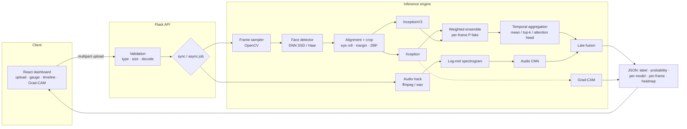

# Multi-Modal Deepfake Detection System

[](https://github.com/srini2k03/multimodal-deepfake-detection/actions/workflows/ci.yml)
[](https://srini2k03.github.io/multimodal-deepfake-detection/)


[](LICENSE)

An end-to-end system for detecting manipulated media. Video frames go through OpenCV face detection and alignment, then an **Xception + InceptionV3 transfer-learning ensemble** scores the face crops. An optional **attention-based temporal head** turns frame scores into a video-level score, and a **mel-spectrogram audio CNN** adds a second modality through **late fusion**. A **Flask REST API** serves the models, and a **React** dashboard shows the probability gauge, a per-frame timeline, **Grad-CAM** heatmaps and the score from each model.

> **Status / honesty note.** This repository contains the full training, evaluation and serving code. It does **not** ship trained weights or benchmark numbers. Without weights, the API runs in a clearly labelled **demo mode** that uses untrained (randomly initialised) networks, and every response carries a warning. To get real results, train the models on a benchmark dataset with the commands below. Then run the evaluation script to fill in the results table.

**Live demo:** <https://srini2k03.github.io/multimodal-deepfake-detection/>. This is a static **browser demo** with no server. It runs the real preprocessing pipeline in your browser: frame sampling, MediaPipe face detection, eye-based alignment and 299×299 crops. It shows the sampled frame timeline and the crops the models would receive. No trained model runs there, so every score on that page is a clearly labelled **placeholder** computed from simple pixel or loudness statistics, not a deepfake verdict. Real detection needs the Python backend with trained weights (see [Quick start](#quick-start)).

---

## Contents

- [Features](#features)
- [Browser demo (GitHub Pages)](#browser-demo-github-pages)
- [Architecture](#architecture)
- [Pipeline details](#pipeline-details)
- [Quick start](#quick-start)
- [Dataset preparation](#dataset-preparation)
- [Training](#training)
- [Evaluation](#evaluation)
- [Inference](#inference)
- [REST API](#rest-api)
- [Frontend](#frontend)
- [Configuration](#configuration)
- [Results](#results)
- [Screenshots](#screenshots)
- [Project structure](#project-structure)
- [Testing and CI](#testing-and-ci)
- [Roadmap](#roadmap)
- [Limitations and responsible use](#limitations-and-responsible-use)
- [References](#references)
- [License](#license)

## Features

| Area | What is implemented |
|---|---|
| Face preprocessing | OpenCV DNN (ResNet-10 SSD) or Haar face detector, eye-based roll alignment without landmarks, square margin crops, uniform/stride frame sampling, on-disk crop cache, multiprocess dataset extraction |
| Datasets | FaceForensics++ (all manipulation methods, any compression), Celeb-DF (official test list) and a generic `real/` + `fake/` layout. Splits are **grouped by identity**, so a person never appears in both train and test |
| Visual models | Xception and InceptionV3 (ImageNet transfer learning), **two-stage fine-tuning** (frozen head training, then partial unfreezing with BatchNorm kept frozen), weighted ensemble |
| Temporal | Frame to video aggregation by mean, median, max, top-k or confidence weighting, or a trainable **attention-pooling** head (`TimeDistributed` CNN + additive attention) |
| Audio | NumPy log-mel spectrograms (no librosa), SpecAugment-style masking, compact CNN, per-segment scores |
| Fusion | Late fusion in probability space or log-odds space; modalities that are missing are dropped and the remaining weights are renormalised |
| Training | `tf.data` pipelines, mixed precision on GPU, class weighting, checkpointing on best val AUC, early stopping, LR scheduling, CSV and TensorBoard logs |
| Evaluation | Frame-level and video-level AUC, accuracy, precision, recall, F1, **EER**, confusion matrix, ROC plot, ensemble-weight tuning on the validation split |
| Explainability | **Grad-CAM** on the last convolutional block of each backbone, returned as base64 PNG overlays |
| API | Flask: `/api/health`, `/api/models`, `/api/predict` (image/video/audio), `/api/jobs/<id>` async jobs, upload validation and size limits, CORS, JSON structured logs with request IDs, consistent JSON errors |
| Frontend | React + Vite: drag-and-drop, upload progress, gauge, interactive per-frame timeline, Grad-CAM opacity slider, per-model bars, audio segment chart. Only `react` and `react-dom` at runtime |
| Ops | Dockerfiles (API + nginx web), docker-compose, Makefile, ruff, pytest, GitHub Actions |

## Browser demo (GitHub Pages)

The site at <https://srini2k03.github.io/multimodal-deepfake-detection/> is the React dashboard built with `VITE_DEMO=browser` (`npm run build:pages`, which reads `frontend/.env.pages`). In this mode the frontend never calls Flask. Instead it does the following:

| Step | In the browser demo | Real? |
|---|---|---|
| Frame sampling | 16 frames at the centre of 16 equal time segments (same rule as `sample_indices`), decoded with a `<video>` element | Yes |
| Face detection | MediaPipe BlazeFace short-range (`@mediapipe/tasks-vision@0.10.35` from jsDelivr; the 230 KB Apache-2.0 model is in `frontend/public/models/`). Largest face kept | Yes |
| Alignment and crop | 30% margin square box, roll correction from the two eye keypoints (±30° limit), 299×299 crop, centre-crop fallback when no face is found | Yes |
| Audio | Web Audio decode, mono 16 kHz, 4 s segments | Yes |
| Scores | Placeholder heuristics: crop sharpness (Laplacian variance), crop colour saturation and segment loudness, squashed to 0..1 and fused with the configured 0.7 / 0.3 weights | **No: placeholders, not a classifier** |
| Grad-CAM | Not available (needs trained models) | n/a |

The page states this in a standing banner and on every result card, shows no "likely manipulated/authentic" verdict, and hides the decision threshold. Nothing is uploaded: files stay in the browser. AVI and MKV files usually cannot be decoded by browsers, so use MP4 (H.264) or WebM there.

`.github/workflows/pages.yml` builds this on every push to `main` (or by manual dispatch) and publishes `frontend/dist` to the `gh-pages` branch with `peaceiris/actions-gh-pages`. To serve it, set **Settings → Pages → Build and deployment** to *Deploy from a branch*, `gh-pages` / `(root)`.

## Architecture



## Pipeline details

**1. Frame sampling.** `sample_indices` picks `N` frames spread evenly across the video (the centre of each of `N` segments), or every `k`-th frame. The frames are decoded in one sequential grab/retrieve pass, which works more reliably than random seeking across codecs.

**2. Face detection.** The default detector is OpenCV's ResNet-10 SSD (`face.detector: dnn`, downloaded by `scripts/download_face_models.sh`). The bundled Haar cascade is used automatically as a fallback. The largest face in each frame is kept.

**3. Alignment without landmarks.** The box is expanded by a relative margin (30% by default) and made square, so the crop keeps the face boundary where blending artifacts appear. A Haar eye cascade runs inside the upper half of the face. When two plausible eyes are found, the frame is rotated about the face centre so the eye line is horizontal. Otherwise the pipeline falls back to bounding-box normalisation only. Crops are resized to 299×299 (the native size of both backbones).

**4. Frame classifiers.** Each backbone (`include_top=False`, global average pooling) feeds a dropout layer and a single-logit head. Inputs are scaled to `[-1, 1]`, which is the preprocessing both Xception and InceptionV3 expect, so one input pipeline serves every model.
- *Stage 1* freezes the backbone and trains only the head (`lr = 1e-3`).
- *Stage 2* unfreezes the top 35% of backbone layers and keeps every BatchNorm layer frozen (`lr = 2e-5`). A checkpoint threshold makes sure stage 2 never overwrites a better stage-1 checkpoint.

**5. Ensemble and temporal aggregation.** The per-frame ensemble score is a convex combination of the backbone scores, and `evaluate --tune-ensemble` grid-searches the weights on the validation split. Frame scores are aggregated into a video score with a configurable method; `topk_mean` is robust when only part of a clip is manipulated. The optional temporal model runs the fine-tuned backbone over `T` frames and pools them with additive attention, `α = softmax(vᵀ tanh(W h_t))`, so it can learn to focus on the few frames that show artifacts.

**6. Audio branch.** The audio track is decoded with ffmpeg (or the stdlib `wave` module for WAV), converted to mono 16 kHz and split into 4 s clips. Each clip becomes a 64-band standardised log-mel spectrogram and is scored by a 3-block CNN. Training adds random time and frequency masking.

**7. Late fusion.** `P = Σ w_m p_m / Σ w_m` over the modalities that are available (visual 0.7, audio 0.3 by default), or the same average in logit space (`fusion.method: logit`). Silent or missing audio is excluded automatically.

**8. Explainability.** Grad-CAM uses the gradient of the pre-sigmoid logit with respect to `block14_sepconv2_act` (Xception) or `mixed10` (InceptionV3). It is computed on the most suspicious frame and returned as an overlay plus the raw crop, so the UI can blend the two.

## Quick start

```bash
git clone https://github.com/srini2k03/multimodal-deepfake-detection.git
cd multimodal-deepfake-detection

# Backend (Python 3.10–3.12 recommended for TensorFlow)
python -m venv .venv && source .venv/bin/activate
make install            # TensorFlow + dev tools  (or: make install-dev for a TF-free setup)
make api                # http://localhost:5000  (demo mode until weights exist)

# Frontend (second terminal)
make frontend-install
make frontend-dev       # http://localhost:5173  (proxies /api to :5000)
```

With Docker:

```bash
docker compose up --build      # web: http://localhost:8080   api: http://localhost:5000
```

Place trained `.keras` files in `backend/weights/` (mounted read-only into the API container) and restart. `/api/health` will then report `"mode": "trained"`.

**Pipeline smoke test.** `make smoke` generates a tiny *synthetic* dataset of drawn shapes, not faces. It then runs extraction, trains every model for one epoch per stage at 96 px on CPU, and evaluates. This checks that the plumbing works end to end. The resulting numbers mean nothing.

## Dataset preparation

Datasets are **not** included. Request access from the dataset authors and respect their licences.

### FaceForensics++

Download with the official script (for example `-c c23 -t videos`) into `backend/data/raw`:

```
data/raw/
├── original_sequences/youtube/c23/videos/000.mp4 ...
└── manipulated_sequences/
    ├── Deepfakes/c23/videos/000_003.mp4 ...
    ├── Face2Face/ FaceSwap/ NeuralTextures/ FaceShifter/
```

```yaml
# configs/ffpp.yaml (copy default.yaml and edit)
data:
  dataset: faceforensics
  raw_root: data/raw
  compression: c23
```

Videos named `000_003` are linked to identities `000` and `003` using union-find. Every connected identity group lands in a single split, which mirrors the pairing used by the official splits.

### Celeb-DF (v1/v2)

```
data/raw/
├── Celeb-real/  ├── YouTube-real/  ├── Celeb-synthesis/
└── List_of_testing_videos.txt
```

Set `data.dataset: celebdf`. Videos in the official test list, and every identity connected to them, go to `test`. The rest is split into train and val.

### Any other dataset

Use `data.dataset: generic` with `raw_root/real/**` and `raw_root/fake/**` (nested folders are fine).

### Audio

Put audio files (or videos with audio tracks) in `data/audio/real/**` and `data/audio/fake/**`. For example, use bona fide and spoofed utterances from ASVspoof 2019 LA, or the audio of FakeAVCeleb. Then run:

```bash
make extract CONFIG=configs/ffpp.yaml          # face crops + data/crops/manifest.csv
make extract-audio CONFIG=configs/ffpp.yaml    # log-mel clips + manifest
```

Extraction is idempotent: videos that were already processed are skipped. Use `--overwrite` to redo them and `--limit N` for a quick trial.

## Training

```bash
cd backend
python -m deepfake_detector.training.train --config configs/ffpp.yaml --model xception
python -m deepfake_detector.training.train --config configs/ffpp.yaml --model inception_v3
python -m deepfake_detector.training.train --config configs/ffpp.yaml --model temporal --backbone xception
python -m deepfake_detector.training.train --config configs/ffpp.yaml --model audio
```

- Each run writes `artifacts/<model>_<timestamp>/` containing `best.keras`, `history.csv`, `run.json` (config, class weights, history) and TensorBoard logs. The best checkpoint is exported to `weights/<name>.keras`, which is where the API looks for it.
- Mixed precision (`mixed_float16`) turns on automatically when a GPU is present and `train.mixed_precision: true`.
- The temporal model starts from the fine-tuned `weights/xception.keras` if it exists.
- You can override settings quickly with `--epochs-head`, `--epochs-finetune` and `--batch-size`, or with environment variables such as `DFD_TRAIN__LR_FINETUNE=1e-5`.

## Evaluation

```bash
python -m deepfake_detector.evaluation.evaluate --config configs/ffpp.yaml --split test --output reports/
python -m deepfake_detector.evaluation.evaluate --config configs/ffpp.yaml --tune-ensemble   # on val split
```

The evaluation writes `reports/metrics.json`, `reports/metrics.md` (a Markdown table you can paste below) and `reports/roc.png`. It reports frame-level and video-level metrics for each backbone, the ensemble and the temporal head.

## Inference

```bash
python -m deepfake_detector.inference.cli path/to/video.mp4 --output result.json --gradcam cam.png
```

```python
from deepfake_detector.config import load_config
from deepfake_detector.inference import DeepfakeDetector

detector = DeepfakeDetector(load_config())
result = detector.predict_file("clip.mp4")   # images, videos and audio files
print(result["label"], result["probability_fake"], result["mode"])
```

## REST API

Base URL: `http://localhost:5000`. Every error has the shape `{"error": {"status", "message", "request_id"}}`, and every response carries an `X-Request-ID` header.

| Method | Path | Description |
|---|---|---|
| `GET` | `/api/health` | Liveness, version and model mode (`trained` / `partial` / `demo`) with a warning when not trained |
| `GET` | `/api/models` | Loaded models and their status (`trained`, `random_weights`, `placeholder`), plus ensemble weights and fusion settings |
| `POST` | `/api/predict` | `multipart/form-data` with a `file` field. Add `?async=1` to get `202 {job_id, status_url}` |
| `GET` | `/api/jobs/<job_id>` | `{status: queued|running|done|error, result, error}` |

**Accepted types:** images `.jpg .jpeg .png .bmp .webp`, videos `.mp4 .avi .mov .mkv .webm`, audio `.wav .flac .mp3 .m4a .ogg`. Every upload is decoded before inference to confirm it is what its extension claims.

**Status codes:**

| Code | Meaning |
|---|---|
| 400 | No file was sent |
| 413 | The file is larger than `api.max_upload_mb`, or the video is longer than `api.max_video_seconds` |
| 415 | The file type is not supported |
| 422 | The file could not be decoded |
| 500 | Unexpected server error (the details are logged, not returned) |

```bash
curl -F file=@clip.mp4 http://localhost:5000/api/predict
```

<details>
<summary>Example response (abridged; values illustrative, from demo mode)</summary>

```json
{
  "media_type": "video",
  "mode": "demo",
  "warning": "DEMO MODE: no trained weights were found, so scores come from untrained ...",
  "label": "REAL",
  "probability_fake": 0.47208,
  "threshold": 0.5,
  "modalities": {
    "visual": {
      "probability": 0.47208,
      "per_model": {
        "xception":     {"probability": 0.42211, "weight": 0.5, "status": "placeholder"},
        "inception_v3": {"probability": 0.52205, "weight": 0.5, "status": "placeholder"}
      },
      "temporal_probability": null,
      "aggregation": "mean",
      "frames": [
        {"index": 0, "timestamp": 0.0, "face_found": true, "probability": 0.51121,
         "per_model": {"xception": 0.59028, "inception_v3": 0.43215}}
      ],
      "faces_detected": 16,
      "frames_analyzed": 16
    },
    "audio": {"available": false, "reason": "no decodable audio stream found"}
  },
  "fusion": {"method": "weighted", "weights": {"visual": 0.7, "audio": 0.3}, "used": ["visual"]},
  "gradcam": {"frame_index": 18, "model": "xception", "method": "pseudo-saliency (demo)",
              "overlay": "data:image/png;base64,...", "face": "data:image/png;base64,..."},
  "processing_ms": 414.5,
  "file": {"name": "clip.avi", "size_bytes": 63700, "frames": 20, "fps": 10.0, "duration": 2.0}
}
```
</details>

**Demo mode.** `api.demo_mode` can be `auto`, `on` or `off`. In `auto`, any backbone without weights is replaced by a randomly initialised Keras model, or by a deterministic hash-based placeholder when TensorFlow is not installed. The response's `mode`, `warning` and per-model `status` fields say so explicitly. Set `demo_mode: off` in production so the API refuses to start without weights.

**Production.** The API image runs gunicorn with one worker process (the models are loaded once) and several threads. Async jobs use an in-process thread pool. For horizontal scaling, replace `api/jobs.py` with Celery or RQ behind the same interface.

## Frontend

The `frontend/` folder holds a React 18 + Vite app with no UI or chart libraries. All charts are hand-written SVG.

- Drag-and-drop or click-to-browse upload, with type checks on the client
- Upload progress bar (XHR). Videos use the async job API with polling
- Semicircular **probability gauge** with the threshold marked, and a verdict
- **Per-frame timeline** with the ensemble line, toggleable per-model lines, threshold, frames with no face, and a hover readout
- **Grad-CAM viewer** with an opacity slider over the analysed face crop
- **Per-model breakdown** (backbones, temporal head, audio CNN, fusion settings) and an audio segment chart
- A prominent banner whenever results come from untrained or demo weights; light and dark themes

Set `VITE_API_BASE` (see `.env.example`) when the UI is hosted apart from the API. In Docker, nginx proxies `/api` to the API container.

`npm run build:pages` produces the static [browser demo](#browser-demo-github-pages) instead: `VITE_DEMO=browser`, base path `/multimodal-deepfake-detection/`, a landing/overview section (architecture diagram, pipeline, models, published benchmark, API summary), and client-side preprocessing with placeholder scores. The regular `npm run build` is unchanged and still talks to the API.

## Configuration

All settings live in [`backend/configs/default.yaml`](backend/configs/default.yaml) and are typed by dataclasses in `deepfake_detector/config.py`. Unknown keys are rejected. Any value can be overridden with `DFD_<SECTION>__<KEY>`, for example:

```bash
DFD_API__MAX_UPLOAD_MB=50 DFD_API__FRAME_AGGREGATION=topk_mean DFD_FUSION__METHOD=logit make api
```

## Results

### Reference benchmark (published)

Published results for the Xception backbone used in this project, from the FaceForensics++ benchmark (Rössler et al., *FaceForensics++: Learning to Detect Manipulated Facial Images*, ICCV 2019). These come from the paper. This repository did not produce them.

| Dataset | Compression | Model | Accuracy |
|---|---|---|---|
| FaceForensics++ (all four manipulations) | Raw | XceptionNet (face crops) | 99.26% |
| FaceForensics++ (all four manipulations) | c23 (HQ) | XceptionNet (face crops) | 95.73% |
| FaceForensics++ (all four manipulations) | c40 (LQ) | XceptionNet (face crops) | 81.00% |

### This repository's results

Fill this table from your own training runs. Run `python -m deepfake_detector.evaluation.evaluate --split test` and paste the generated `reports/metrics.md` here.

| Dataset (split) | Model | Level | AUC | Accuracy | F1 | EER |
|---|---|---|---|---|---|---|
| FaceForensics++ c23 (test) | Xception | video | _TBD_ | _TBD_ | _TBD_ | _TBD_ |
| FaceForensics++ c23 (test) | InceptionV3 | video | _TBD_ | _TBD_ | _TBD_ | _TBD_ |
| FaceForensics++ c23 (test) | Ensemble | video | _TBD_ | _TBD_ | _TBD_ | _TBD_ |
| FaceForensics++ c23 (test) | Temporal (attention) | video | _TBD_ | _TBD_ | _TBD_ | _TBD_ |
| Celeb-DF v2 (official test) | Ensemble (cross-dataset) | video | _TBD_ | _TBD_ | _TBD_ | _TBD_ |

## Screenshots

| Result dashboard (browser demo, placeholder scores) | Upload | Grad-CAM |
|---|---|---|
| [](docs/screenshots/dashboard.png) | _to add: `docs/screenshots/upload.png`_ | _to add: `docs/screenshots/gradcam.png` (needs trained weights)_ |

The dashboard screenshot comes from the [live browser demo](https://srini2k03.github.io/multimodal-deepfake-detection/) after uploading a short generated clip built from a public-domain NASA portrait. The face boxes, sampled frames and aligned crops are real pipeline output. The scores are placeholders, not model predictions.

## Project structure

```
multimodal-deepfake-detection/
├── backend/
│   ├── deepfake_detector/
│   │   ├── config.py               # typed YAML config + env overrides
│   │   ├── preprocessing/          # face_detector, alignment, video sampling, pipeline (cache), audio, extract CLI
│   │   ├── data/                   # dataset layouts + identity-grouped splits, tf.data pipelines
│   │   ├── models/                 # Xception/InceptionV3 classifiers, ensemble, attention temporal head, audio CNN
│   │   ├── training/train.py       # two-stage fine-tuning CLI
│   │   ├── evaluation/             # NumPy metrics (AUC/EER/F1/CM) + evaluation CLI
│   │   ├── explain/gradcam.py      # Grad-CAM + overlays
│   │   ├── inference/              # DeepfakeDetector, scorers, aggregation + late fusion, CLI
│   │   ├── api/                    # Flask app factory, validation, async jobs
│   │   └── utils/                  # JSON logging, optional-dependency helpers
│   ├── configs/                    # default.yaml, smoke.yaml
│   ├── scripts/                    # face-model download, synthetic smoke dataset
│   ├── tests/                      # pytest suite (TF tests auto-skip without TensorFlow)
│   ├── weights/                    # put trained *.keras files here (git-ignored)
│   ├── Dockerfile  gunicorn.conf.py  wsgi.py  pyproject.toml  requirements*.txt
├── frontend/
│   ├── src/components/             # UploadZone, ProbabilityGauge, FrameTimeline, GradCamViewer, ModelBreakdown, Overview, ...
│   ├── src/demo/                   # browser demo: client-side sampling, face detection, alignment, placeholder scores
│   ├── public/models/              # BlazeFace short-range .tflite for the browser demo
│   ├── src/api.js  App.jsx  styles.css  .env.pages
│   └── Dockerfile  nginx.conf  vite.config.js  package.json
├── .github/workflows/          # ci.yml, pages.yml (browser demo -> gh-pages)
├── docker-compose.yml  Makefile  LICENSE  README.md
```

## Testing and CI

```bash
make lint        # ruff check + format check
make test        # full suite (TensorFlow tests included when TF is installed)
make test-fast   # only tests that do not need TensorFlow
```

The model tests build both backbones at 75×75 with random weights, so nothing is downloaded. They cover the ensemble, both temporal pooling modes (including a save/load round trip), the audio CNN, Grad-CAM and loading trained weights. The API tests use a mocked detector and also run one end-to-end request in placeholder demo mode.

GitHub Actions runs ruff, then pytest in two jobs (one without TensorFlow, one with `tensorflow-cpu`), then the frontend production build. A separate `Pages` workflow builds the browser demo and publishes it to `gh-pages`.

## Roadmap

- [ ] Train and publish reproducible baselines on FaceForensics++ c23 and Celeb-DF v2, and fill in the results table
- [ ] Optional landmark-based alignment (e.g. MediaPipe Face Mesh) as an alternative to eye-cascade roll correction
- [ ] EfficientNet/ConvNeXt backbones and a frequency-domain (DCT/FFT) branch
- [ ] Learned fusion head trained on paired audio-visual data (e.g. FakeAVCeleb) and lip-sync consistency features
- [ ] Probability calibration (temperature scaling) and robustness tests under re-compression
- [ ] Multi-face tracking across frames instead of taking the largest face per frame
- [ ] Persistent job queue (Redis/RQ), result caching by file hash and rate limiting
- [ ] ONNX / TF-Lite export for faster CPU inference
- [ ] Frontend unit tests and screenshot automation

## Limitations and responsible use

- Detectors trained on one manipulation family or dataset often generalise poorly to unseen generators, heavy compression or adversarial post-processing. Treat scores as evidence to investigate, not as verdicts.
- Haar and SSD face detection miss profile, occluded and very small faces. Frames without a face fall back to a centre crop and are flagged in the response.
- Use benchmark datasets under their licences and only for research. Do not use this tool to harass or to make high-stakes decisions without human review.

## References

- Rössler et al., *FaceForensics++: Learning to Detect Manipulated Facial Images*, ICCV 2019.
- Li et al., *Celeb-DF: A Large-scale Challenging Dataset for DeepFake Forensics*, CVPR 2020.
- Chollet, *Xception: Deep Learning with Depthwise Separable Convolutions*, CVPR 2017.
- Szegedy et al., *Rethinking the Inception Architecture for Computer Vision*, CVPR 2016.
- Selvaraju et al., *Grad-CAM: Visual Explanations from Deep Networks via Gradient-based Localization*, ICCV 2017.
- Bahdanau et al., *Neural Machine Translation by Jointly Learning to Align and Translate*, ICLR 2015 (additive attention).
- Park et al., *SpecAugment*, Interspeech 2019.

## License

[MIT](LICENSE) © 2025 Srinivasan Balasubramanian
