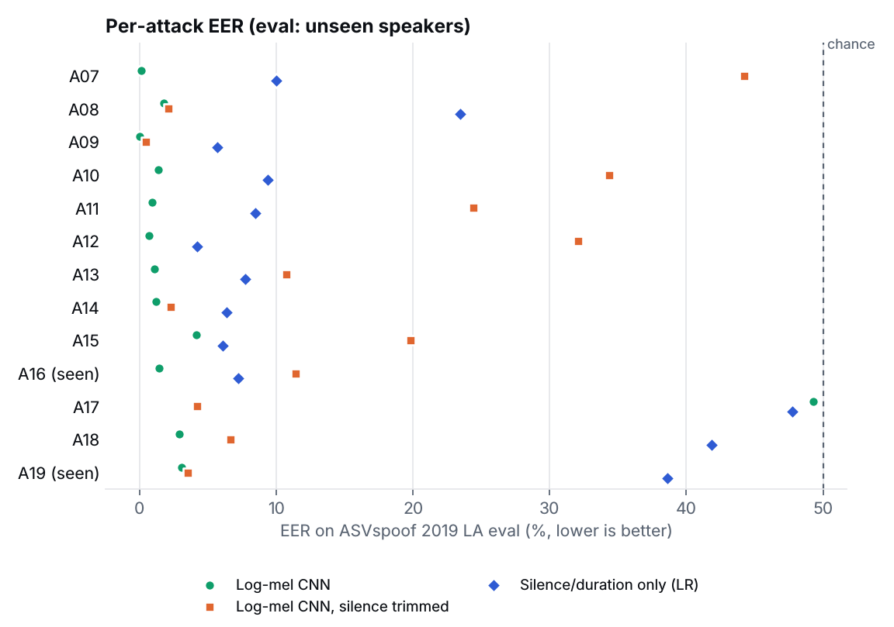
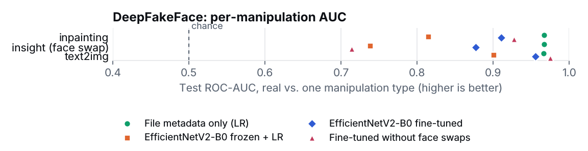
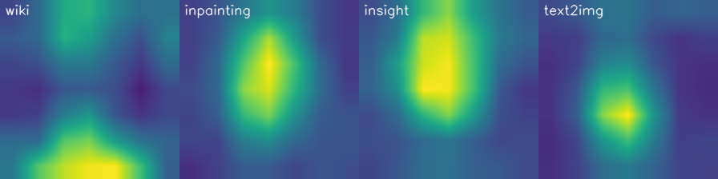

# Benchmarks

What was measured, how, and what the numbers do and do not show. Every number on this page comes
from a file that a benchmark workflow committed to [`results/`](../results). Each file records the
workflow run ID, commit SHA, date, runner and package versions. The tables between the markers below
are generated by `backend/scripts/make_report.py` from those files. Do not edit them by hand.

- Audio: [`benchmark-audio.yml`](../.github/workflows/benchmark-audio.yml) →
  [`results/audio/asvspoof2019_la/`](../results/audio/asvspoof2019_la)
- Visual: [`benchmark-visual.yml`](../.github/workflows/benchmark-visual.yml) →
  [`results/visual/dff/`](../results/visual/dff)
- Dataset decisions and licences: [DATASETS.md](DATASETS.md)

All training and evaluation ran on GitHub-hosted CPU runners (4 vCPU, 16 GB RAM, no GPU). That
budget is why the models are small and why the visual benchmark uses a sample of the dataset.

## Protocol

### Audio branch: ASVspoof 2019 LA

| | |
|---|---|
| Data | Official train / dev / eval protocols, speaker-disjoint. Eval holds 13 attacks; 11 of them (A07–A15, A17, A18) never appear in training. |
| Input | 16 kHz mono, first 4 s of each utterance (shorter ones are repeat-padded), 64-band log-mel (25 ms Hann window, 10 ms hop), standardised per clip. |
| Systems | `silence_lr`: logistic regression on duration and leading/trailing silence only. `logmel_lr`: logistic regression on per-band log-mel mean and std. `cnn`: the repository's 3-block log-mel CNN (154,641 parameters). `cnn_trim`: the same CNN trained and tested on audio with leading/trailing silence removed (frames more than 40 dB below the peak frame). |
| Training | Adam 1e-3, batch 64, class-balanced epochs (every bona fide utterance plus three times as many sampled spoofs), SpecAugment (one frequency and one time mask), at most 20 epochs, learning rate halved after 2 epochs without improvement, early stopping after 4. The epoch with the lowest dev EER is kept. Seed 1234, deterministic TensorFlow ops. |
| Operating point | The threshold is set at the dev-set EER point and applied unchanged to eval. Platt scaling is fitted on dev. |
| Metrics | EER and minimum t-DCF (ASVspoof 2019 cost model, using the organisers' ASV scores), ROC-AUC, PR-AUC (spoof = positive), confusion matrix, FPR and FNR at the dev threshold, ECE and Brier score before and after calibration, per-attack EER. |
| Cross-dataset | In-the-Wild (real public figures, 2022). Scored once with the ASVspoof-dev threshold and calibration; nothing is tuned on it. |
| Robustness | A stratified eval subset (all attacks plus bona fide) under white noise (30/20/10/5 dB SNR), telephone band (8 kHz), MP3 32 kbps, Opus 16 kbps, −20 dB gain, truncation to 1 s and 2 s, silence trimming and a prepended second of near-silence. |

### Visual branch: DeepFakeFace (image level)

| | |
|---|---|
| Data | DFF: real IMDB-WIKI celebrity photos (`wiki`) plus three fakes derived from each one: Stable Diffusion inpainting, InsightFace face swap and Stable Diffusion v1.5 text-to-image. Whole identities are assigned to train / val / test (10% val, 15% test, seeded hash), so no person appears in two splits. A sample of identities is used: each brings one real photo and its three fakes. |
| Input | The repository's own face pipeline (Haar detector, eye-based roll alignment, 30% margin, 224×224 crop). Every crop is re-encoded as JPEG q95, real and fake alike. |
| Systems | `meta_lr`: logistic regression on file metadata only (format, resolution, bytes per pixel, face-box size); it never sees pixels, so it is a shortcut probe. `effnet_probe`: frozen ImageNet EfficientNetV2-B0 features plus logistic regression. `effnet_ft`: EfficientNetV2-B0 fine-tuned (1 head epoch, then the top 30% of layers with BatchNorm frozen, Adam 1e-4, at most 5 epochs, early stopping on val AUC), class-balanced epochs, augmentation applied to both classes (flip, random JPEG q60–95, down/up-scaling, brightness). `effnet_ft_eq96`: as `effnet_ft`, but every crop is down-sampled to 96 px and back first. `*_no_<type>`: trained without one manipulation type (leave one generator out). |
| Operating point | The threshold is set at the validation EER point. Platt scaling is fitted on validation. |
| Metrics | ROC-AUC, PR-AUC (fake = positive), EER, confusion matrix, FPR and FNR at the validation threshold, ECE and Brier score, per-manipulation AUC (real test photos against one fake type), and **face-size-matched AUC**: AUC within quantile bins of the source face size, pooled by pair count. |
| Cross-dataset (video) | WildDeepfake test split ([`benchmark-visual-cross.yml`](../.github/workflows/benchmark-visual-cross.yml)): internet deepfake videos as face sequences. Up to 16 frames per sequence go through the same face pipeline. Frame scores are aggregated per sequence by mean, median, max, top-k mean and confidence weighting, so frame-level and video-level AUC can be compared. Nothing is fitted on it. |
| Robustness | A stratified test subset under JPEG q90/70/50/30, down-scaling ×0.5/×0.25, Gaussian blur σ 1/2, Gaussian noise σ 5/15, brightness ×0.7/×1.3 and an 80% centre crop. |
| Explainability | Grad-CAM is computed on a stratified test subset. Only aggregate statistics and mean heatmaps are committed (no dataset faces): the share of heat in the central face region and in the lower face. |

### Latency and export

Each benchmark run times every pipeline stage on the runner. For audio: FLAC decode, log-mel and
the CNN at batch 1 and batch 64. For images: face detection with alignment and crop, the
classifier at batch 1 and batch 16, and Grad-CAM. Both models are exported to TFLite (fp32 and
dynamic-range int8), and the exports are checked against Keras: the maximum probability difference,
and for audio also EER on a stratified subset. The browser port of the audio model is checked
against Python on a fixed signal (log-mel and per-clip logits) before every Pages deployment.

<!-- tables:start -->
<!-- generated by backend/scripts/make_report.py from results/ - do not edit -->

## Results: audio (ASVspoof 2019 LA)

_Run 45371433877 at commit `e93f2a3` on 2026-11-24 (Linux x86_64 cpus=4); scores in `results/audio/asvspoof2019_la/eval_scores.csv.gz`._

| System | Dev EER | Eval EER | Eval min t-DCF | Eval ROC-AUC | Eval PR-AUC (spoof) | FPR @ dev thr. | FNR @ dev thr. | ECE raw → Platt |
|---|---|---|---|---|---|---|---|---|
| Silence/duration only (LR) | 29.00% | **17.74%** | 0.4763 | 0.8632 | 0.9756 | 32.90% | 13.40% | 0.223 → 0.039 |
| Log-mel statistics (LR) | 12.95% | **17.14%** | 0.4556 | 0.9080 | 0.9868 | 4.53% | 35.57% | 0.266 → 0.130 |
| Log-mel CNN | 0.48% | **7.65%** | 0.1381 | 0.9600 | 0.9955 | 0.97% | 12.27% | 0.087 → 0.087 |
| Log-mel CNN on trimmed audio | 11.11% | **21.58%** | 0.5906 | 0.8706 | 0.9818 | 10.54% | 35.53% | 0.078 → 0.110 |
| Log-mel CNN, silence trimmed | 5.81% | **19.01%** | 0.4493 | 0.8934 | 0.9866 | 4.47% | 34.49% | 0.171 → 0.168 |

Per-attack EER (eval):

| Attack | Log-mel CNN | Log-mel CNN, silence trimmed | Silence/duration only (LR) |
|---|---|---|---|
| A07 | 0.12% | 44.26% | 9.99% |
| A08 | 1.75% | 2.14% | 23.47% |
| A09 | 0.00% | 0.49% | 5.70% |
| A10 | 1.37% | 34.33% | 9.36% |
| A11 | 0.90% | 24.42% | 8.47% |
| A12 | 0.67% | 32.11% | 4.19% |
| A13 | 1.10% | 10.73% | 7.71% |
| A14 | 1.18% | 2.28% | 6.39% |
| A15 | 4.13% | 19.82% | 6.10% |
| A16 | 1.43% | 11.39% | 7.22% |
| A17 | 49.29% | 4.21% | 47.74% |
| A18 | 2.91% | 6.66% | 41.84% |
| A19 | 3.06% | 3.54% | 38.60% |

Robustness (stratified eval subset, n = 4250):

| Condition | Log-mel CNN EER | Log-mel CNN, silence trimmed EER | Log-mel CNN FPR @ dev thr. | Log-mel CNN, silence trimmed FPR @ dev thr. |
|---|---|---|---|---|
| clean | 7.82% | 19.50% | 0.90% | 4.40% |
| noise_snr30 | 15.12% | 17.39% | 1.60% | 6.60% |
| noise_snr20 | 27.82% | 21.92% | 22.40% | 5.70% |
| noise_snr10 | 62.62% | 27.58% | 71.70% | 30.90% |
| noise_snr5 | 70.19% | 27.10% | 83.70% | 72.50% |
| telephone_8k | 15.68% | 20.69% | 0.10% | 6.30% |
| mp3_32k | 12.02% | 20.90% | 4.10% | 10.00% |
| opus_16k | 10.10% | 18.50% | 18.20% | 16.80% |
| gain_minus20db | 17.30% | 19.01% | 12.90% | 11.20% |
| truncate_1s | 9.22% | 59.71% | 4.40% | 79.60% |
| truncate_2s | 8.21% | 25.09% | 1.40% | 15.60% |
| trim_silence | 23.09% | 19.50% | 55.20% | 4.40% |
| prepend_1s_silence | 12.00% | 19.60% | 100.00% | 4.40% |

Cross-dataset: In-the-Wild (31,779 clips, 54 speakers; no tuning on it):

| System | EER | ROC-AUC | FPR @ ASVspoof-dev thr. | FNR @ ASVspoof-dev thr. |
|---|---|---|---|---|
| Silence/duration only (LR) | 49.65% | 0.5044 | 96.71% | 2.36% |
| Log-mel statistics (LR) | 64.23% | 0.3144 | 92.02% | 27.63% |
| Log-mel CNN | 47.86% | 0.5030 | 95.83% | 23.60% |
| Log-mel CNN, silence trimmed | 45.46% | 0.5610 | 89.80% | 6.83% |

## Results: visual (DeepFakeFace)

_Run 45373710322 at commit `33a8f42` on 2026-11-24 (Linux x86_64 cpus=4); scores in `results/visual/dff/test_scores.csv.gz`._

| System | Val AUC | Test ROC-AUC | Face-size-matched AUC | Test EER | PR-AUC (fake) | FPR @ val thr. | FNR @ val thr. | AUC inpainting | AUC face swap | AUC text2img |
|---|---|---|---|---|---|---|---|---|---|---|
| EfficientNetV2-B0 fine-tuned | 0.9173 | **0.9144** | 0.9099 | 16.92% | 0.9693 | 16.72% | 17.15% | 0.9106 | 0.8774 | 0.9554 |
| Fine-tuned, 96 px resolution cap | 0.9001 | **0.8939** | 0.8907 | 19.33% | 0.9623 | 19.04% | 19.44% | 0.9022 | 0.8335 | 0.9459 |
| Fine-tuned without face swaps | 0.8811 | **0.8723** | 0.8702 | 21.28% | 0.9560 | 20.40% | 22.11% | 0.9274 | 0.7142 (unseen) | 0.9751 |
| EfficientNetV2-B0 frozen + LR | 0.8266 | **0.8178** | 0.8171 | 26.16% | 0.9274 | 26.00% | 26.33% | 0.8146 | 0.7384 | 0.9005 |
| Frozen + LR without inpainting | 0.8092 | **0.7989** | 0.7978 | 27.91% | 0.9204 | 28.08% | 27.73% | 0.7445 (unseen) | 0.7426 | 0.9096 |
| Frozen + LR without face swaps | 0.8131 | **0.7985** | 0.7993 | 27.57% | 0.9231 | 27.32% | 27.73% | 0.8276 | 0.6348 (unseen) | 0.9332 |
| Frozen + LR without text2img | 0.7551 | **0.7589** | 0.7585 | 31.08% | 0.8983 | 31.92% | 30.53% | 0.8203 | 0.7813 | 0.6750 (unseen) |
| File metadata only (LR) | 0.9722 | **0.9669** | 0.9637 | 5.64% | 0.9601 | 5.76% | 5.13% | 0.9670 | 0.9669 | 0.9666 |

Robustness (test subset, n = 1200):

| Condition | EfficientNetV2-B0 frozen + LR AUC | EfficientNetV2-B0 fine-tuned AUC | EfficientNetV2-B0 frozen + LR FPR @ val thr. | EfficientNetV2-B0 fine-tuned FPR @ val thr. |
|---|---|---|---|---|
| clean | 0.8226 | 0.9132 | 25.67% | 16.67% |
| jpeg_q90 | 0.8073 | 0.9065 | 23.00% | 18.83% |
| jpeg_q70 | 0.7971 | 0.9001 | 40.33% | 21.33% |
| jpeg_q50 | 0.7848 | 0.8928 | 41.00% | 22.67% |
| jpeg_q30 | 0.7717 | 0.8845 | 42.67% | 21.50% |
| downscale_0.5 | 0.7748 | 0.8821 | 78.83% | 35.17% |
| downscale_0.25 | 0.7162 | 0.8441 | 92.83% | 41.50% |
| blur_sigma1 | 0.7752 | 0.8828 | 79.33% | 34.83% |
| blur_sigma2 | 0.7195 | 0.8427 | 96.33% | 53.67% |
| noise_sigma5 | 0.7657 | 0.8927 | 6.67% | 11.83% |
| noise_sigma15 | 0.7498 | 0.8623 | 4.33% | 10.00% |
| brightness_0.7 | 0.8154 | 0.9112 | 22.33% | 15.00% |
| brightness_1.3 | 0.8180 | 0.9062 | 26.67% | 17.33% |
| crop_0.8 | 0.8335 | 0.8901 | 50.33% | 29.67% |

Cross-dataset, video level: WildDeepfake test (157 videos, 806 face sequences, 12,896 frames; nothing fitted on it):

| System | Frame AUC | Sequence AUC (mean) | Sequence AUC (median) | Sequence AUC (max) | Sequence AUC (topk_mean) | Sequence AUC (confidence_weighted) |
|---|---|---|---|---|---|---|
| EfficientNetV2-B0 fine-tuned | 0.6284 | 0.6529 | 0.6485 | 0.6454 | 0.6482 | 0.6523 |
| Fine-tuned, 96 px resolution cap | 0.5803 | 0.5964 | 0.5905 | 0.5812 | 0.5835 | 0.5958 |
<!-- tables:end -->

## Interpretation

<!-- interpretation:start -->
### Audio

1. **The untrimmed CNN's 7.65% eval EER leans on silence.** In the audit, the median leading
   silence is 0.71 s for bona fide and 0.33 s for spoofed training utterances, and 0.75 s against
   0.04 s on eval (`data_audit.json`). A logistic regression that sees only duration and
   silence lengths reaches **17.74% eval EER**, as well as a log-mel statistics baseline (17.14%).
   The same CNN scored on silence-trimmed eval audio rises from 7.65% to **21.58%**.
   Attack A17 (waveform-filtering voice conversion, which keeps bona fide-like silence) is at
   chance for both the untrimmed CNN (49.29%) and the silence-only baseline (47.74%).
2. **The silence-trimmed CNN is worse in-benchmark but behaves more like a speech detector.** Its eval
   EER is 19.01% (min t-DCF 0.449), but it detects A17 at 4.21% EER, and it is far more stable
   under perturbation. At 10 dB SNR white noise the untrimmed CNN reaches 62.62% EER, the trimmed
   one 27.58%. Prepending one second of near-silence makes the untrimmed CNN flag **100%** of bona
   fide clips at its dev threshold, while the trimmed CNN stays at 4.40%. The trimmed CNN fails on
   several TTS attacks (A07 44.26%, A10 34.33%, A12 32.11%) and on 1 s clips (59.71%), because a
   repeat-padded 1 s clip looks nothing like the 4 s training input. It is the model served by the
   API and the browser demo, because its failure modes are about speech rather than file padding.
3. **No system generalises to In-the-Wild.** Speeches of public figures, scored with the ASVspoof
   threshold, give 45.46% EER (trimmed CNN, ROC-AUC 0.561) and 47.86% (untrimmed CNN, AUC 0.503).
   At the transferred threshold, 89.80% and 95.83% of real clips are flagged. The log-mel statistics
   baseline is worse than chance (AUC 0.314). The dataset reverses ASVspoof's silence pattern:
   median leading silence is 0.00 s for bona fide and 0.23 s for spoofed clips
   (`cross_dataset_in_the_wild.json`), so cues learned from ASVspoof point the wrong way. A model
   trained on ASVspoof 2019 LA alone should not be trusted on real-world audio. The browser and API
   both say so next to the score.
4. **Calibration.** Platt scaling on dev cuts ECE sharply for the linear baselines (silence-only
   0.223 → 0.039) but not for the CNNs (0.087 → 0.087 and 0.171 → 0.168), because the dev/eval
   shift (unseen attacks) dominates. The served probabilities are also re-weighted to equal priors
   (dev is 90% spoofed).
5. **Latency and export.** On a 4-vCPU runner, FLAC decode takes 0.84 ms and the 4 s log-mel 1.79 ms
   per utterance. The CNN takes 15.9 ms in Keras at batch 1, 2.2 ms as TFLite fp32 and 1.4 ms as
   dynamic-range int8 (168 KB). The int8 model's EER on the 4,250-clip parity subset equals Keras
   (18.11% for the trimmed CNN), with a maximum probability difference of 0.026. The JavaScript port
   matches Python to 7e-7 (log-mel) and 1.5e-6 (logit), at 516 ms per 4 s clip in Node
   (`browser_parity.json`).

### Visual

1. **DeepFakeFace leaks its labels through file properties.** Every fake in the test sample is a
   512×512 JPEG. The real photos are web JPEGs (2,404 of 2,500) of varied size: median 440×532,
   5th percentile 234 px wide. A logistic regression on format, resolution, bytes per pixel and
   face-box size, **without looking at a single pixel, reaches test ROC-AUC 0.967**, which is higher
   than every image model. Any DFF number has to be read against that.
2. **The image models do not simply learn resolution, but they are not clean either.** Crops are
   re-encoded identically and resized to 224 px. The fine-tuned EfficientNetV2-B0 reaches test
   ROC-AUC **0.914** (EER 16.92%), and **0.910** when AUC is computed only within bins of similar
   source face size. Capping every crop at 96 px (both classes) costs little: 0.894, or 0.891
   matched. Fine-tuning adds 0.096 AUC over the frozen ImageNet probe (0.818).
3. **Unseen manipulation types are much harder.** With InsightFace swaps held out of training, AUC
   on swaps drops from 0.877 to **0.714**, while the other two types stay at or above their seen
   level (0.927 / 0.975). Frozen-probe leave-one-out shows the same pattern for every type (swaps
   0.738 → 0.635, inpainting 0.815 → 0.744, text-to-image 0.901 → 0.675).
4. **Robustness: blur and down-scaling create false alarms on real photos.** On the 1,200-image
   test subset, the fine-tuned model's AUC stays between 0.862 and 0.911 under JPEG q30–q90,
   Gaussian noise and brightness changes. Its false-positive rate at the validation threshold rises from 16.67% to
   **53.67%** under Gaussian blur σ 2 and to 41.50% under ×0.25 down-scaling. Softer, lower-quality
   real photos are pushed towards "fake".
5. **What Grad-CAM shows (diagnostic, n = 300).** On real photos, 0.20 of the heat mass falls in the
   central quarter of the crop (which covers 0.25 of its area) and 0.51 in the lower face. On
   inpainting and text-to-image fakes, the central share rises to 0.44 and 0.41. The model looks
   more at the face centre when it calls a fake, which is consistent with the inpainted regions,
   but this shows where its evidence sits, not that those pixels are synthetic.
   
6. **Cross-dataset, video level: barely above chance.** On the WildDeepfake test split (157 internet
   videos, 806 face sequences, 12,896 sampled frames; nothing fitted on it), the fine-tuned model
   reaches frame-level ROC-AUC **0.628**. Aggregating to sequence level helps a little: mean 0.653,
   confidence-weighted 0.652, median 0.649, top-25% mean 0.648, max 0.645. Mean aggregation is the
   API default and the best here by a small margin. The attention-pooling head could not be compared,
   because no lawful labelled video training data is available. The 96 px model transfers worse
   (0.580 / 0.596). A detector trained on DeepFakeFace stills should not be expected to catch
   in-the-wild face-swap videos.
7. **Latency.** Face detection, alignment and crop take 33 ms per image. The classifier takes 181 ms
   at Keras batch 1 (eager overhead), 25 ms per image at batch 16, and 6.9 ms as TFLite fp32
   (max probability difference to Keras 1.7e-6). Dynamic-range int8 TFLite is **not** recommended
   for the visual model: its maximum probability difference to Keras is 0.19. Grad-CAM costs
   406 ms per image.

### Fusion

Not evaluated: there is no lawful paired audio-visual data (see [DATASETS.md](DATASETS.md)).
<!-- interpretation:end -->

## What these benchmarks cannot tell you

- **No fusion result.** None of the lawful datasets pairs labelled audio and video of the same
  clip, so the fused score is not evaluated. See [DATASETS.md](DATASETS.md).
- **The visual benchmark is image-level and generator-specific.** DFF holds diffusion-model and
  InsightFace manipulations of still celebrity photos. It says nothing about video deepfakes,
  temporal artefacts, other face-swap pipelines or lip-sync attacks. The video aggregation and the
  attention head are not evaluated here.
- **ASVspoof 2019 LA is clean, read English speech with 2019-era synthesis.** Modern TTS and voice
  cloning, other languages, channels and compression are out of domain. The In-the-Wild result shows
  how far performance drops outside the benchmark.
- **One seed per system.** The runs are deterministic for a given seed, but seed-to-seed variance
  was not measured, so small differences between systems should not be over-read.
- **Calibration is fitted on the validation split of the same dataset.** Under distribution shift
  (new generators, new channels) the probabilities are not calibrated.
